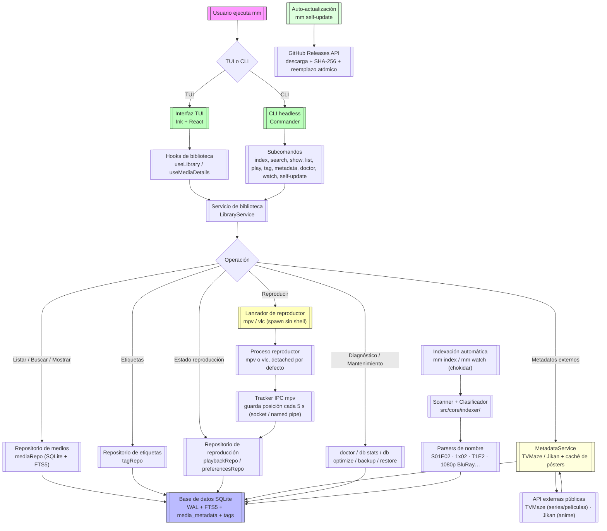

<p align="center">
  
</p>

<h1 align="center">media-manager</h1>

<p align="center">
  <strong>Gestor de contenido multimedia 100 % terminal</strong><br/>
  Indexa tu colección de series, anime y películas en una base de datos SQLite local<br/>
  y lánzala directamente en <code>mpv</code> o <code>vlc</code> sin salir de la terminal.
</p>

<p align="center">
  <a href="https://github.com/Angel-p-v/media-manager/releases/latest">
    
  </a>
  <a href="https://github.com/Angel-p-v/media-manager/actions/workflows/ci.yml">
    
  </a>
  <a href="https://github.com/Angel-p-v/media-manager/blob/main/LICENSE">
    
  </a>
  <a href="https://nodejs.org/">
    
  </a>
  <a href="https://github.com/Angel-p-v/media-manager/releases">
    
  </a>
</p>

---

## 🎬 Demo

<p align="center">
  
</p>

> **La demo es una transcripción estática de una sesión real.** Para probarla en tu terminal, empieza por la sección de [instalación rápida](#instalación-rápida).

---

## ⚡ Comenzando en 30 segundos

```bash
# 1. Clona e instala (Linux, sin sudo)
git clone https://github.com/Angel-p-v/media-manager.git
cd media-manager
sh installers/linux/install.sh

# 2. Abrir la interfaz
mm

# 3. Desde la CLI
mm search "cowboy bebop"
mm play "cowboy bebop" --resume   # reanuda donde lo dejaste
mm index                          # re-escanea tu biblioteca
```

Windows y macOS: véase [Instalación rápida](#instalación-rápida).

---

## 🎯 ¿Qué es media-manager?

`media-manager` (CLI: `mm`) es una aplicación de línea de comandos **100% terminal** para organizar y consumir una biblioteca multimedia personal que ya vive en tu disco.

> **La idea es sencilla:** tus vídeos ya están ordenados en carpetas; el trabajo de la aplicación es **entender** esa estructura, guardarla en un índice rápido y ponerte a ver algo en dos pulsaciones.

```bash
mm                       # abre la interfaz (TUI) con tu biblioteca
mm search "cowboy bebop" # busca por título desde la terminal, al instante
mm play "cowboy bebop"   # lanza el episodio en tu reproductor favorito
mm index                 # re-escanea tus carpetas y actualiza el índice
```

---

## ✨ ¿Por qué media-manager?

| 🎯 **Centralizar el acceso**       | Una sola entrada (`mm`) a toda tu colección, sin depender del explorador de archivos ni de la web del servidor de streaming.                                 |
| ---------------------------------- | ------------------------------------------------------------------------------------------------------------------------------------------------------------ |
| ⚡ **Indexer local, instantáneo**  | Un índice SQLite con FTS5 convierte "buscar entre 10 000 ficheros" en "buscar entre 10 000 filas" con búsqueda full-text.                                    |
| 🎮 **Reproducir, no retransmitir** | El vídeo se abre en tu reproductor local (`mpv`, `vlc`) con el hardware y la calidad que ya tienes; la app solo orquesta el proceso.                         |
| ⚙️ **Configurable de verdad**      | Rutas, exclusiones, reproductores, tema y atajos de teclado viven en un `config.yaml` externo, validado estrictamente al arrancar.                           |
| 🔧 **Componible**                  | Todo lo que hace la TUI se puede hacer también por línea de comandos y en formato `--json`, para integrarlo con scripts, hooks o cualquier otra herramienta. |

---

## ✨ Características principales

| Capacidad                                                           | Estado |
| ------------------------------------------------------------------- | ------ |
| 🖥️ TUI navegable (Ink + React)                                      | ✅     |
| 🗃️ Índice local en SQLite con FTS5                                  | ✅     |
| 🔄 Indexación recursiva + incremental                               | ✅     |
| 🎯 Parseo inteligente (`S01E02`, `1x02`, `T1E2`, `1080p BluRay`)    | ✅     |
| 🔍 Búsqueda instantánea (CLI + TUI)                                 | ✅     |
| 🎮 Reproducción con `mpv` / `vlc`                                   | ✅     |
| ⚙️ Configuración YAML validada con Zod                              | ✅     |
| 👀 Modo _watch_ (reindexado automático)                             | ✅     |
| 📤 Salida `--json` para scripts                                     | ✅     |
| 📝 Logs estructurados, `--verbose`, errores con código              | ✅     |
| 🗄️ Mantenimiento SQLite (`optimize` / `VACUUM`)                     | ✅     |
| ✅ Instalador verificado, checksums, distribución portable          | ✅     |
| ▶️ Estado de reproducción (continuar, historial, marcas)            | ✅     |
| 📡 Tracker IPC mpv (reanudación automática y guardado de posición)  | ✅     |
| 🎮 Comandos `continue`, `history`, `mark`, `favorite`, `doctor`     | ✅     |
| 📃 Comando `playlist` (reproduce varios títulos en secuencia)       | ✅     |
| 🗄️ Comandos `db stats`, `db optimize`, `db backup`, `db restore`    | ✅     |
| 🏷️ Comandos `tag add/remove/list` y filtro `list --tag`             | ✅     |
| 🔄 Auto-actualización con `self-update`                             | ✅     |
| 📋 Sección "Continuar" en la TUI                                    | ✅     |
| 🧩 Integración con reproductor (mpv/vlc, modo detach/foreground)    | ✅     |
| 🧪 Tests E2E con IPC falso y `--dry-run`                            | ✅     |
| 🎞️ Metadatos externos TVMaze/Jikan (sinopsis, póster, calificación) | ✅     |
| 🖼️ Renderizado de pósters en terminal (Kitty SGP + chafa fallback)  | ✅     |
| 🔄 Sincronización automática de metadatos con TTL                   | ✅     |
| 🤖 Metadatos automáticos tipo Sonarr/Radarr (`autoFetch`)           | ✅     |

## 🚀 Instalación rápida

### 📦 Instalador oficial (recomendado — Linux, Windows)

Clona el repositorio y ejecuta el instalador correspondiente para tu sistema.

#### Linux (x64, arm64)

```bash
# 1. Clona el repositorio
git clone https://github.com/Angel-p-v/media-manager.git
cd media-manager

# 2. Instala dependencias de Node (requerido para modo repositorio)
npm ci

# 3. Ejecuta el instalador (sin sudo, instala en ~/.local)
sh installers/linux/install.sh

# Si ya está instalado, usa --force para reinstalar:
# sh installers/linux/install.sh --force

# 4. Verifica
mm --version
```

> 💡 Asegúrate de que `~/.local/bin` esté en tu PATH **antes** de otros gestores de versión (como `mise`, `nvm`, etc.) para que `mm` se resuelva correctamente.

> 📦 Alternativa: si no quieres clonar el repositorio, descarga el instalador directamente y obtendrá un release precompilado de GitHub Releases (no requiere node ni npm):
>
> ```bash
> curl -fsSL https://raw.githubusercontent.com/Angel-p-v/media-manager/main/installers/linux/install.sh -o /tmp/mm-install.sh
> sh /tmp/mm-install.sh
> ```

#### Windows (x64)

```powershell
# 1. Clona el repositorio
git clone https://github.com/Angel-p-v/media-manager.git
cd media-manager

# 2. Ejecuta el instalador
.\installers\windows\install.ps1

# 3. Verifica
mm --version
```

#### macOS (x64, arm64)

> **Nota:** No hay assets oficiales de macOS en las releases públicas (pendiente de runners de GitHub Actions con macOS). Consulta [`installers/macos/README.md`](./installers/macos/README.md) para compilar e instalar en macOS.

Para compilar en macOS:

```bash
npm run standalone -- --node-source official
```

> **Opciones útiles:**
>
> ```bash
> sh installers/linux/install.sh --prefix "$HOME/.local"
> sh installers/linux/install.sh --dry-run            # muestra los cambios sin aplicarlos
> ```

---

### 🖼️ Renderizado de pósters en terminal

media-manager puede mostrar los pósters de tus series y películas directamente en la TUI. Usa dos estrategias según la terminal:

**1. Protocolo gráfico nativo (Kitty SGP)**
En terminales que soporten el [Protocolo Gráfico de Kitty (SGP)](https://sw.kovidgoyal.net/kitty/graphics-protocol/) —Ghostty, Kitty, WezTerm— se renderiza el póster como imagen nativa con nitidez y proporción correcta, usando `ink-picture`. Esto requiere `MEDIA_MANAGER_GRAPHICS=native` o que el terminal se detecte automáticamente (variable `GHOSTTY_RESOURCES_DIR`, `KITTY_WINDOW_ID` o `TERM_PROGRAM`).

**2. Fallback ANSI (`chafa`)**
En terminales sin gráficos nativos, se usa `chafa --format=symbols --symbols=sextant` para renderizar arte Unicode con colores ANSI. La resolución es limitada (2×3 subpíxeles por celda) y nunca se verá como un 4K, pero es legible.

| Terminal              | Protocolo      | Calidad           |
| --------------------- | -------------- | ----------------- |
| Ghostty               | Kitty SGP      | 🟢 Nativa         |
| Kitty                 | Kitty SGP      | 🟢 Nativa         |
| WezTerm               | Kitty SGP      | 🟢 Nativa         |
| iTerm2                | —              | 🟡 Fallback chafa |
| Terminal sin gráficos | chafa símbolos | 🟡 Unicode ANSI   |

Si `chafa` no está disponible, la aplicación funciona normalmente pero muestra un placeholder de texto en lugar del póster.

#### Instalación de chafa (fallback)

- **Linux**: el instalador (`installers/linux/install.sh`) intenta instalar `chafa` automáticamente con el gestor de paquetes del sistema (`apt`, `dnf`, `yum`, `pacman`, `apk` o `brew`). Si no puede (por falta de privilegios), se muestra un aviso y puedes instalarlo manualmente (por ejemplo, `sudo apt install chafa`).
- **Windows**: el instalador (`installers/windows/install.ps1`) intenta instalar `chafa` mediante `winget` o `chocolatey`.
- **macOS**: instala `chafa` manualmente (por ejemplo, `brew install chafa`).

---

## 🔧 Dependencias del sistema

Además del binario `mm` (que ya incluye Node.js embalado en las distribuciones oficiales), media-manager necesita algunos programas del sistema para funcionar al 100 %:

| Dependencia      | Para qué sirve                                          | Obligatoria         | Instalación                                                                        |
| ---------------- | ------------------------------------------------------- | ------------------- | ---------------------------------------------------------------------------------- |
| **mpv**          | Reproductor principal (recomendado)                     | ❌ (una de mpv/vlc) | `sudo apt install mpv` / `winget install mpv` / `brew install mpv`                 |
| **vlc**          | Reproductor alternativo                                 | ❌ (una de mpv/vlc) | `sudo apt install vlc` / `winget install videolan.vlc` / `brew install --cask vlc` |
| **chafa**        | Renderizado de pósters en terminal (fallback ANSI)      | ❌                  | `sudo apt install chafa` / `winget install chafa` / `brew install chafa`           |
| **Node.js ≥ 22** | Solo si clonás el repo y corrés desde fuente (`npm ci`) | ⚠️ Solo modo fuente | [`nodejs.org`](https://nodejs.org/) o tu gestor de versión                         |

> 💡 Ninguna de estas dependencias es estrictamente obligatoria para usar la TUI o buscar: si no tenés reproductor, `mm play` te avisará; si no tenés `chafa`, verás un placeholder de texto en lugar del póster.

### Ver qué falta en tu sistema

```bash
mm doctor
```

`mm doctor` te dice qué reproductores, herramientas y entradas del índice están disponibles o faltan, y puede limpiar entradas rotas con `--prune-missing`.

---

## 🗑️ Desinstalar

```bash
# Clona el repositorio si aún no lo tienes
git clone https://github.com/Angel-p-v/media-manager.git
cd media-manager

# Ejecuta el desinstalador (sin sudo)
sh installers/linux/uninstall.sh            # conserva configuración y base de datos
sh installers/linux/uninstall.sh --purge    # las elimina también
```

> 🛡️ La biblioteca multimedia nunca se toca.

#### macOS: si Gatekeeper bloquea el binario

Si al ejecutar `mm` ves un error de "app no verificada" o "no se puede abrir porque no es de un desarrollador identificado":

```bash
# Quita el atributo de cuarentena de los binarios instalados
xattr -d com.apple.quarantine ~/.local/share/media-manager/dist/cli.js ~/.local/bin/mm
```

El instalador intenta hacerlo automáticamente, pero en algunos casos macOS lo reaplica.

---

## 🚀 Uso rápido

```bash
# 🖥️ Interfaz visual (TUI)
mm

# 🔍 Buscar y reproducir
mm search "cowboy bebop"
mm play "cowboy bebop" --resume    # reanuda donde lo dejaste
mm play "cowboy bebop" --next      # siguiente episodio no visto
mm play "akira" --dry-run          # muestra el comando sin lanzar

# 📋 Gestión de biblioteca
mm index                           # escanea y actualiza
mm list --in-progress              # títulos en curso
mm continue                        # lista lo que estás viendo
mm history                         # historial de reproducción

# ✅ Gestión de estado
mm mark "cowboy bebop" --watched       # marca como visto
mm mark "cowboy bebop" --position 120  # guarda posición exacta
mm favorite "cowboy bebop"             # ⭐ favorito
mm doctor                              # diagnóstico biblioteca
mm doctor --prune-missing              # limpia entradas rotas

# 👀 Modo vigilancia
mm watch                           # reindexa automáticamente al detectar cambios

# 🏷️ Etiquetas y colecciones
mm tag list                        # lista todas las etiquetas
mm tag add 1 "por-ver"             # asigna etiqueta al título #1
mm tag remove 1 "por-ver"          # quita etiqueta del título #1
mm list --tag 1                    # filtra por etiqueta (repetible para AND)

# 🔄 Auto-actualización
mm self-update --check             # comprueba si hay actualización
mm self-update                     # descarga e instala la nueva versión
mm self-update --dry-run           # muestra qué se haría sin instalar

# 🎞️ Metadatos externos (TVMaze/Jikan)
mm metadata search "cowboy bebop"  # busca en TVMaze/Jikan
mm metadata fetch 12345            # obtiene y guarda metadatos por ID
mm metadata clear                  # limpia metadatos de un título
```

---

## ⌨️ Atajos en la TUI

| Tecla          | Acción                                                            |
| -------------- | ----------------------------------------------------------------- |
| `q` / `Ctrl+C` | Salir                                                             |
| `Tab`          | Siguiente sección (Todo, **Continuar**, Series, Anime, Películas) |
| `↑` `↓`        | Mover selección                                                   |
| `/`            | Buscar • `Esc` vuelve                                             |
| `p`            | ▶️ Reproducir                                                     |
| `w`            | Marcar visto / no visto                                           |
| `f`            | ⭐ Favorito / quitar favorito                                     |
| `m`            | 📋 Mostrar/ocultar panel de detalles                              |
| `r`            | 🔄 Obtener metadatos del título seleccionado                      |
| `n`            | ▶️ Siguiente episodio                                             |
| `g`            | 🔄 Ciclo filtros (todos / en curso / no vistos / favoritos)       |
| `s`            | ⚙️ Configuración                                                  |
| `?`            | ❓ Ayuda                                                          |
| `k`            | ⌨️ Reasignar atajos de teclado (desde la TUI)                     |

---

## 🐚 Autocompletado de shell

`mm` puede generar scripts de autocompletado para Bash, Zsh y Fish:

```bash
# Generar el script
mm completion bash   # o: zsh | fish

# Instalar (ejemplos para Bash)
mm completion bash > /etc/bash_completion.d/mm
# o para usuario:
mm completion bash >> ~/.bashrc

# Zsh
mm completion zsh > /usr/local/share/zsh/site-functions/_mm
# o para usuario:
mm completion zsh >> ~/.zshrc

# Fish
mm completion fish > ~/.config/fish/completions/mm.fish
```

Después de instalar, reinicia la shell o recarga su configuración para que los comandos y opciones de `mm` se autocompleten al presionar <kbd>Tab</kbd>.

---

## ⚙️ Configuración

Archivo: `~/.config/media-manager/config.yaml` (respeta `XDG_CONFIG_HOME`)

```yaml
version: 1

library:
  roots:
    - path: ~/Media/Anime
      type: anime
      label: Anime
    - path: ~/Media/Series
      type: series
      label: Series
    - path: ~/Media/Peliculas
      type: movie
      label: Películas
  exclude:
    - '**/*.sample.*'
    - '**/sample/**'
  scan:
    followSymlinks: false
    maxDepth: 4

database:
  path: ~/.local/share/media-manager/library.db

player:
  default: mpv
  onLaunch: detach
  players:
    mpv:
      command: mpv
      args: ['--force-window=immediate', '--start={start}', '{file}']
    vlc:
      command: vlc
      args: ['--started-from-file', '--start-time={start}', '{file}']

playback: # 🎬 Estado de reproducción
  tracking: auto # auto | manual | off (solo mpv)
  resume: true # reanudar por defecto
  resumeMinSeconds: 30 # mínimo para reanudar
  completedThreshold: 0.9 # 90% = completado
  completedTailSeconds: 30 # últimos 30s = completado

ui:
  theme: default
  layout: split
  sort: title

logging:
  level: warn
  format: text

metadata:
  cacheTtlHours: 24 # horas antes de refrescar metadatos
  autoFetch: false # true = obtener metadatos al abrir la TUI

keybindings:
  quit: q
  help: '?'
  search: /
  play: p
  nextSection: tab
```

### 🤖 Metadatos automáticos (tipo Sonarr/Radarr)

Si activas `metadata.autoFetch: true`, al abrir la TUI se buscarán automáticamente los metadatos de **todos los títulos que no los tienen aún**, usando proveedores públicos gratuitos (TVMaze para series/películas, Jikan para anime), sin que tengas que pulsar `r` en cada uno individualmente.

```yaml
metadata:
  autoFetch: true
```

El proceso respeta el rate limiting de cada proveedor y procesa los títulos en lotes para no bloquear la aplicación. Al finalizar, verás un resumen en la barra de estado con cuántos metadatos se obtuvieron y cuántos fallaron.

> **💡 Por defecto** `autoFetch` está desactivado (`false`) para no hacer llamadas API inesperadas.

> **⌨️ Tecla `r`**: si prefieres obtener metadatos título por título manualmente, pulsa `r` sobre cualquier título seleccionado en la biblioteca.

> **💡 Placeholder `{start}`**: si la plantilla lo incluye y hay posición de reanudación, se sustituye por los segundos; si no hay reanudación, se elimina el argumento completo.

### Variables de entorno

| Variable           | Efecto                             |
| ------------------ | ---------------------------------- |
| `MM_CONFIG`        | Ruta alternativa del YAML          |
| `MM_DATABASE_PATH` | Ruta alternativa de la base SQLite |
| `MM_PLAYER`        | Reproductor por defecto            |
| `MM_LOG_LEVEL`     | Nivel logging (`silent`…`debug`)   |
| `MM_LOG_FORMAT`    | Formato (`text` o `json`)          |
| `NO_COLOR`         | Desactiva colores                  |

---

## 🏗️ Arquitectura

Principio rector: **la lógica de negocio no sabe que existe una terminal.**

```
src/
├─ cli.tsx        # punto de entrada; delega en commands/ o en la TUI
├─ commands/      # subcomandos headless (no dependen de Ink)
├─ core/          # dominio puro: config, db, indexer, library, player
├─ ui/            # presentación con Ink (React) — solo consume core/
└─ shared/        # utilidades transversales: errores, logger, rutas
```

**Reglas verificadas en CI:**

- `core/` **nunca** importa desde `ui/`
- `ui/` y `commands/` usan casos de uso, no SQL directo
- Acceso a datos por repositorios con `Database` inyectada

---

## 📊 Diagrama de flujos



---

## 🛠️ Desarrollo

```bash
npm install          # instala dependencias (prepara hooks Husky)
npm run dev          # CLI en modo watch
npm run verify       # lint + formato + tipos + tests (gate local)
npm test             # suite completa (635 tests)
npm run test:unit    # solo unitarias
npm run test:integration
npm run test:e2e
npm run coverage     # informe de cobertura
npm run bench        # benchmarks
npm run smoke        # npm pack → instalación limpia → smoke test
npm run standalone   # distribución portable con Node incluido
```

### Calidad y CI

| Herramienta             | Configuración                         |
| ----------------------- | ------------------------------------- |
| **ESLint 10**           | type-aware + `typescript-eslint`      |
| **Prettier 3**          | formato consistente                   |
| **Vitest 5**            | 3 proyectos: unit / integration / e2e |
| **Husky + lint-staged** | formato + lint en pre-commit          |
| **commitlint**          | Conventional Commits                  |
| **CI (GitHub Actions)** | Node 22/24/26 + smoke test real       |

---

## 📚 Documentación

| Documento                                                      | Descripción                      |
| -------------------------------------------------------------- | -------------------------------- |
| [`PLAN.md`](./PLAN.md)                                         | Plan de desarrollo por hitos     |
| [`docs/README.md`](./docs/README.md)                           | Índice de documentación          |
| [`docs/guides/architecture.md`](./docs/guides/architecture.md) | Decisiones técnicas              |
| [`docs/guides/performance.md`](./docs/guides/performance.md)   | Presupuesto y benchmarks         |
| [`docs/guides/release.md`](./docs/guides/release.md)           | Publicación, tags y credenciales |
| [`docs/adr/`](./docs/adr)                                      | Architecture Decision Records    |
| [`docs/plans/`](./docs/plans)                                  | Planes de trabajo                |
| [`CHANGELOG.md`](./CHANGELOG.md)                               | Historial de versiones           |
| [`SECURITY.md`](./SECURITY.md)                                 | Reportar vulnerabilidades        |
| [`CONTRIBUTING.md`](./CONTRIBUTING.md)                         | Flujo de desarrollo y PRs        |

---

## 📄 Licencia

[MIT](./LICENSE) © 2026 media-manager contributors

<p align="center">
  <sub>Hecho con ❤️ para quienes prefieren la terminal.</sub><br/>
  <sub><a href="https://github.com/Angel-p-v/media-manager/issues">Reportar bug</a> • <a href="https://github.com/Angel-p-v/media-manager/discussions">Preguntar</a> • <a href="https://github.com/Angel-p-v/media-manager/blob/main/CONTRIBUTING.md">Contribuir</a></sub>
</p>
