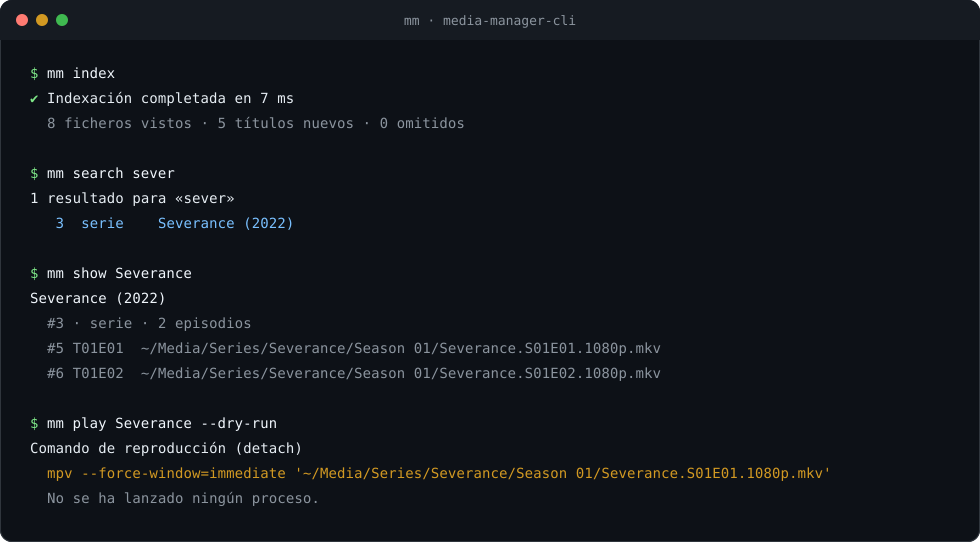

# media-manager

> Gestor de contenido multimedia **100 % terminal**. Indexa tu colección de series, anime y
> películas en una base de datos SQLite local y lánzala directamente en `mpv` o `vlc` sin salir
> de la terminal.

[](https://nodejs.org)
[](./LICENSE)
[](#estado-del-proyecto)

---

## Demo



La demo es una transcripción estática de una sesión real contra la biblioteca de pruebas.
Para probarla en tu terminal, empieza por la sección de [instalación](#instalación).

## ¿Qué es?

`media-manager-cli` (CLI: `mm`) es una aplicación de línea de comandos para organizar y
consumir una biblioteca multimedia personal que ya vive en tu disco.

La idea es sencilla: **tus vídeos ya están ordenados en carpetas**; el trabajo de la
aplicación es _entender_ esa estructura, guardarla en un índice rápido y ponerte a ver
algo en dos pulsaciones.

```
mm            →  abre la interfaz (TUI) con tu biblioteca
mm search     →  busca por título desde la terminal, al instante
mm play       →  lanza el episodio o la película en tu reproductor favorito
mm index      →  re-escanea tus carpetas y actualiza el índice
```

## ¿Para qué sirve?

- **Centralizar el acceso.** Una sola entrada (`mm`) a toda tu colección, sin depender del
  explorador de archivos ni de la web del servidor de streaming.
- **Indexer local, instantáneo.** Un índice SQLite (con FTS5) convierte "buscar entre
  10 000 ficheros" en "buscar entre 10 000 filas" con búsqueda _full-text_.
- **Reproducir, no retransmitir.** El vídeo se abre en el reproductor local (`mpv`, `vlc`)
  con el hardware y la calidad que ya tienes; la app solo orquesta el proceso.
- **Configurable de verdad.** Rutas, exclusiones, reproductores, tema y atajos de
  teclado viven en un `config.yaml` externo, validado estrictamente al arrancar.
- **Componible.** Todo lo que hace la TUI se puede hacer también por línea de
  comandos y en formato `--json`, para integrarlo con scripts, hooks o cualquier otra
  herramienta.

## Características

| Capacidad                                                    | Estado |
| ------------------------------------------------------------ | ------ |
| TUI navegable (Ink + React)                                  | ✅ M5  |
| Índice local en SQLite con FTS5                              | ✅ M2  |
| Indexación recursiva + incremental                           | ✅ M3  |
| Parseo de nombres (`S01E02`, `1x02`, `T1E2`, `1080p BluRay`) | ✅ M3  |
| Búsqueda instantánea en línea de comandos                    | ✅ M4  |
| Reproducción con `mpv` / `vlc`                               | ✅ M6  |
| Configuración YAML validada con Zod                          | ✅ M1  |
| Modo _watch_ (reindexado automático)                         | ✅ M6  |
| Salida `--json` para scripts                                 | ✅ M4  |
| Logs estructurados, `--verbose` y errores con código         | ✅ M7  |
| Mantenimiento SQLite (`optimize` / `VACUUM`)                 | ✅ M7  |
| Paquete npm, tarball smoke y distribución portable           | 🟡 M8  |

## Estado del proyecto

**Release `v1.0.0` en preparación.** El paquete se llamará `media-manager-cli` en npm;
la publicación queda pendiente de las credenciales del mantenedor. El plan de desarrollo
completo, con hitos, criterios de aceptación y estrategia de pruebas, vive en
[`PLAN.md`](./PLAN.md).

| Hito | Contenido                     | Versión    |
| ---- | ----------------------------- | ---------- |
| M0   | Cimientos: tooling, hooks, CI | `0.0.1` ✅ |
| M1   | Núcleo de configuración       | `0.1.0` ✅ |
| M2   | Persistencia SQLite           | `0.2.0` ✅ |
| M3   | Indexación y parseo           | `0.3.0` ✅ |
| M4   | CLI _headless_ + búsqueda     | `0.4.0` ✅ |
| M5   | TUI (Ink)                     | `0.5.0` ✅ |
| M6   | Reproductor + modo watch      | `0.6.0` ✅ |
| M7   | Robustez y rendimiento        | `0.7.0` ✅ |
| M8   | Publicación `v1.0.0`          | `1.0.0` 🟡 |

## Requisitos

- **Node.js ≥ 22** (probado en 22, 24 y 26)
- Un reproductor local: [`mpv`](https://mpv.io/) (recomendado) o `vlc`
- SQLite (viene embebido; no requiere instalación)

## Instalación

Cuando `v1.0.0` esté publicada en npm:

```bash
npm install --global media-manager-cli
mm --version
mm --help
```

> La publicación está preparada pero pendiente de las credenciales de npm. Hasta
> entonces, instala desde el código fuente:

```bash
git clone https://github.com/Angel-p-v/media-manager.git
cd media-manager
npm ci
npm run build
npm link             # deja `mm` disponible en el PATH
mm --version
```

Para ejecutar sin instalar el binario global:

```bash
npm run dev          # CLI en modo watch desde el código fuente
node dist/cli.js --help
```

El paquete npm incluye `dist/`, la configuración de ejemplo, el README, el CHANGELOG,
las políticas de seguridad y contribución y la demo. Los detalles de publicación están
en [`docs/guides/release.md`](./docs/guides/release.md).

## Uso

```bash
mm                       # interfaz TUI a pantalla completa
mm index                 # escanea las raíces configuradas y actualiza el índice
mm index --dry-run       # simula el escaneo sin tocar la base de datos
mm list                  # enumera la biblioteca
mm search "cowboy bebop" # búsqueda por título
mm search "akira" --json # salida para scripts
mm show "cowboy bebop"   # detalle de un título (temporadas, episodios, rutas)
mm play "cowboy bebop"   # abre el primer episodio (o el fichero con --file) en mpv/vlc
mm play "akira" --dry-run # muestra el comando sin lanzar el reproductor
mm watch                 # vigila las raíces y reindexa al detectar cambios
mm config --path          # ruta del archivo de configuración en uso
mm db stats               # tamaño de la biblioteca y del índice
mm db optimize            # actualiza estadísticas de SQLite
mm db optimize --vacuum   # además compacta el fichero (puede tardar)
mm index --verbose        # diagnóstico detallado por stderr
```

`mm play` acepta `--file <id>` para elegir un fichero concreto (el id aparece en
`mm show`), `--player <nombre>` para usar otro reproductor de los configurados,
`--foreground` para esperar a que termine y `--dry-run` para inspeccionar el comando.
La salida `--json` de `mm play --dry-run` incluye el comando, los argumentos, el modo y
el fichero resuelto.

### Logs y diagnóstico

Los logs se escriben **siempre en `stderr`**, nunca en `stdout`. `--verbose` (`-v`) fuerza
el nivel `debug` y añade la pila a los errores; funciona antes o después del subcomando.
El nivel y el formato también se configuran en `logging` o con variables de entorno:

```bash
MM_LOG_FORMAT=json mm search "akira" --verbose > resultados.json 2> diagnostico.log
```

`logging.format: json` emite una línea JSON por evento con `time`, `level`, `event` y
campos estructurados. `logging.level` acepta `silent`, `error`, `warn`, `info` y `debug`
(por defecto `warn`).

### Códigos de salida

| Código | Significado                                                       |
| ------ | ----------------------------------------------------------------- |
| `0`    | Éxito                                                             |
| `1`    | Error de ejecución (configuración, base de datos, título ausente) |
| `2`    | Uso incorrecto (comando u opción inválidos, falta un argumento)   |

Los errores de ejecución se imprimen en `stderr` con un código estable delante:
`[CONFIG_ERROR]`, `[DB_ERROR]`, `[INDEX_ERROR]`, `[PLAYER_ERROR]`, `[NOT_FOUND]`,
`[AMBIGUOUS]` o `[APP_ERROR]` para fallos inesperados. Con `--verbose` se añade la pila
del error.

La salida `--json` es el contrato estable para scripts: un único objeto JSON por
`stdout`, sin colores. Los errores se escriben en `stderr`.

### TUI

`mm` sin argumentos abre la interfaz a pantalla completa. Atajos por defecto (todos se
pueden cambiar en `keybindings` de la configuración):

| Tecla   | Acción                                   |
| ------- | ---------------------------------------- |
| `q`     | salir (también `Ctrl+C`)                 |
| `Tab`   | siguiente sección (todo, series, anime…) |
| `↑` `↓` | mover la selección                       |
| `/`     | abrir el buscador; `Esc` vuelve          |
| `s`     | ver la configuración efectiva            |
| `?`     | ayuda con los atajos                     |
| `p`     | reproducir el primer fichero del título  |

## Configuración

Ubicación por defecto: `~/.config/media-manager/config.yaml`
(se respeta `XDG_CONFIG_HOME`; se puede forzar con `MM_CONFIG=/ruta/config.yaml`).

```yaml
version: 1

library:
  roots:
    - path: ~/Media/Anime
      type: anime
      label: Anime
    - path: ~/Media/Series
      type: series
      label: Series
    - path: ~/Media/Peliculas
      type: movie
      label: Películas
  exclude:
    - '**/*.sample.*'
    - '**/sample/**'
  scan:
    followSymlinks: false
    maxDepth: 4

database:
  path: ~/.local/share/media-manager/library.db

player:
  default: mpv
  onLaunch: detach
  players:
    mpv:
      command: mpv
      args: ['--force-window=immediate', '{file}']
    vlc:
      command: vlc
      args: ['--started-from-file', '{file}']

ui:
  theme: default
  layout: split
  sort: title

logging:
  level: warn
  format: text

keybindings:
  quit: q
  help: '?'
  search: /
  play: p
  nextSection: tab
```

`{file}` es obligatorio en la plantilla de `args`: se sustituye por la ruta del vídeo
como un argumento independiente (nunca se pasa por una shell). `onLaunch: detach` no
bloquea la terminal y el reproductor sigue vivo si cierras la TUI; `foreground` espera a
que termine. La TUI usa siempre `detach` para no congelarse.

Precedencia de la configuración: `defaults → archivo YAML → variables de entorno → flags`.

| Variable           | Efecto                                    |
| ------------------ | ----------------------------------------- |
| `MM_CONFIG`        | ruta alternativa del archivo YAML         |
| `MM_DATABASE_PATH` | ruta alternativa de la base SQLite        |
| `MM_PLAYER`        | reproductor por defecto                   |
| `MM_LOG_LEVEL`     | nivel de logging (`silent`…`debug`)       |
| `MM_LOG_FORMAT`    | formato de logging (`text` o `json`)      |
| `NO_COLOR`         | desactiva colores en la salida de usuario |

## Arquitectura

Principio rector: **la lógica de negocio no sabe que existe una terminal.**

```
src/
├─ cli.tsx        # punto de entrada; delega en commands/ o en la TUI
├─ commands/      # subcomandos headless (no dependen de Ink)
├─ core/          # dominio puro: config, db, indexer, library, player
├─ ui/            # presentación con Ink (React) — solo consume `core/`
└─ shared/        # utilidades transversales: errores, logger, rutas
```

Reglas que se verifican automáticamente con tests:

- `core/` **nunca** importa desde `ui/` (dependencias hacia dentro).
- `ui/` y `commands/` hablan con el dominio mediante casos de uso, no con SQL directo.
- El acceso a datos se hace por repositorios con la `Database` inyectada.

## Desarrollo

```bash
npm install          # instala dependencias (prepara los hooks de Husky)
npm run dev          # CLI en modo watch
npm run verify       # lint + formato + tipos + tests  (gate local)
npm test             # suite completa (incluye el test de estrés)
npm run test:unit    # solo unitarias (rápidas)
npm run test:integration
npm run test:e2e
npm run coverage     # informe de cobertura
npm run bench        # benchmarks de escaneo, indexado y consultas
npm run smoke        # npm pack → instalación limpia → smoke de la CLI
npm run standalone   # distribución portable con Node incluido (opcional)
```

Calidad y convenciones:

- **ESLint 10** con reglas _type-aware_ (`typescript-eslint`) + **Prettier 3**.
- **Vitest 5** con tres proyectos: `unit`, `integration` y `e2e`.
- **Husky** + **lint-staged** (formato y lint en el commit) + **commitlint**
  ([Conventional Commits](https://www.conventionalcommits.org/)).
- **CI** en GitHub Actions: lint, formato, tipos, build y tests en Node 22/24/26, más un
  job que instala el tarball real y ejecuta el smoke.

Contribución: consultar [`PLAN.md`](./PLAN.md) y [`CONTRIBUTING.md`](./CONTRIBUTING.md).

## Documentación

- [`PLAN.md`](./PLAN.md) — plan de desarrollo por hitos
- [`docs/README.md`](./docs/README.md) — índice de la documentación
- [`docs/guides/architecture.md`](./docs/guides/architecture.md) — decisiones técnicas
- [`docs/guides/performance.md`](./docs/guides/performance.md) — presupuesto y benchmarks
- [`docs/guides/release.md`](./docs/guides/release.md) — publicación, tags y credenciales
- [`docs/adr/`](./docs/adr) — _Architecture Decision Records_
- [`docs/plans/`](./docs/plans) — planes de trabajo
- [`CHANGELOG.md`](./CHANGELOG.md) — historial de versiones
- [`SECURITY.md`](./SECURITY.md) — cómo reportar vulnerabilidades
- [`CONTRIBUTING.md`](./CONTRIBUTING.md) — flujo de desarrollo y PRs

## Licencia

[MIT](./LICENSE) © 2026 media-manager contributors
